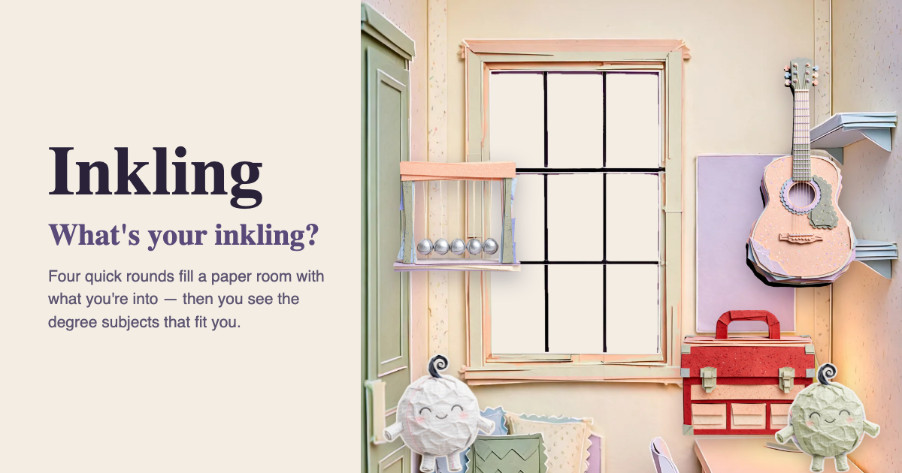
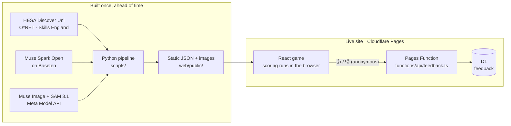

# Inkling

**A game that helps UK students find the degree subjects that fit them.** Four quick rounds of cards fill a paper-craft halls room with what you're into. Then you get your top 3 subjects, a wildcard you'd never have picked, real UK courses and the apprenticeships closest to them.

**Play it:** [findyourinkling.com](https://www.findyourinkling.com) · **Watch the simulation:** [/simulation](https://www.findyourinkling.com/simulation) · **How it was built:** [/built](https://www.findyourinkling.com/built) · **Demo video:** _add link_

Built solo for the Meta Global AI Developer Hackathon (26 Oct – 4 Nov 2026), Indie Developer track, problem statement **Build for Your World**.



## The problem

I build university websites. Their main job is getting students to pick a course from a huge catalogue, and they assume you already know what subject you want. Many students don't. In the 2026 cycle 344,760 UK 18-year-olds applied to university by the 30 June deadline ([UCAS](https://www.ucas.com/corporate/news-and-key-documents/news/record-number-of-uk-school-leavers-head-into-the-results-period-with-an-offer-of-a-university-or)), choosing from tens of thousands of courses. Among graduates aged 25 to 30, 15% would pick a different course at the same university and 12% would change both course and university ([The Benefits of Hindsight](https://wonkhe.com/blogs/hindsight-is-a-wonderful-thing-but-foresight-is-better/), Bristol, HEPI and Advance HE, 2025).

Inkling helps students find the inkling they already have, then explore real options from there. It is a game, not a chatbot or a personality test, and it never makes up facts about courses.

## What it does

1. **Your subjects.** Tap what you study now and heart your favourites. Type anything else (A-levels, BTECs, T-levels, Highers) and it understands.
2. **Things you'd get stuck into.** Swipe picture cards yes or no.
3. **This or that.** Pick the picture that's more you.
4. **Big questions.** Swipe on questions you'd want answered; swipe up if you really want to know.
5. **Your room.** Whatever you pick lands in your room as a paper sticker. Tap any sticker to see which subject it stands for.
6. **The reveal.** Your top 3, a wildcard, hands-on routes (apprenticeships), real courses filtered by city, coast, campus town or countryside, and a 10-second video of your room to share.
7. **Feedback.** "Does this feel like you?" 👍 / 👎, stored anonymously to tune the scoring.

No sign-up. Playing makes **zero AI calls**: everything AI-made was generated once ahead of time, so the site is static and costs almost nothing to run at any scale.

## How Meta's models are used

| Model | How | What it did | Scale | Scripts |
| --- | --- | --- | --- | --- |
| **Muse Spark Open** (open weights) | `meta-models/muse-spark-open-1026` on Baseten | Wrote a card for every UK degree subject, then reviewed its own cards | 163 cards, 74 changed in review | `subject_cards.py`, `apply_card_overrides.py` |
| | | Taught the text box what teenagers type | 2,481 aliases + 70 school and college subjects | `subject_aliases.py` |
| | | Rated real course titles for relevance to each subject | 5,118 titles | `course_relevance.py` |
| | | Tagged every UK teaching location's setting | 695 locations | `campus_settings.py` |
| | | Linked live apprenticeship standards to subjects | 499 standards, 159 of 163 subjects | `apprenticeship_links.py` |
| | | Wrote and played 200 simulated students to test the scoring | 200 personas, every round | `simulate_students.py` |
| | via Aider | Wrote the `/built` page and the feedback feature (reviewed and tidied by hand) | | `prompts/18_*`, `prompts/20_feedback.md` |
| **Muse Image** | Meta Model API, `muse-image-1.0` | Drew the whole paper world in one diorama style | Halls room (plus a tall phone version), 162 stickers, 16 window views, 34 card pictures, 11 paper pals, 13 simulation buildings | `build_room.py`, `build_room_tall.py`, `build_stickers.py`, `build_cards.py`, `build_characters.py`, `build_buildings.py` |
| **SAM 3.1** | Meta Model API, `sam-3.1` | Finds and checks the object in every sticker render (stickers are cut out on a green key) | Every sticker | `build_stickers.py`, `image_check.py` |
| **Muse Code** | Coding agent | Coding partner for most of the build, driven by the prompts in `prompts/` | 20 prompts | `prompts/` |

**Live during play:**

| Feature | Model | Function | What happens |
| --- | --- | --- | --- |
| Your inkling | Muse Spark 1.2 · Meta Model API (falls back to Spark Open on Baseten) | `POST /api/inkling` | Writes two or three sentences about how your answers connect to your top 3, streamed onto the page, with a “Your wildcard,” sentence when you have one. Falls back to the cards alone. |
| Your paper pal | Muse Image · Meta Model API | `POST /api/pal` | Draws a paper pal of your top subject's paper type holding its room object, on the share page and share image. Hidden on failure. |
| Live students | Muse Spark Open · Baseten (falls back to Muse Spark on the Meta Model API) | `POST /api/student` | “Run a live student” on `/simulation` writes and plays one new student live (streamed log); the browser scores them and walks them to their building. |

Each live call has a second provider: the inkling runs on Muse Spark via the Meta Model API and falls back to Spark Open on Baseten; the live student runs on Spark Open on Baseten and falls back to Muse Spark. The page says which one answered.

Keys live in Cloudflare Pages secrets (`BASETEN_API_KEY`, `MODEL_API_KEY`); for local dev they sit in `.dev.vars` (git-ignored). Nothing the models write during play is stored.

**Why open weights:** every text step runs on an open model, so a school, careers service or exam board could run the whole pipeline on its own servers, in its own language, and keep pupils' answers in-house.

## Testing it before real students: the simulation

Spark Open wrote 200 varied UK 16–18 year olds, each with the subjects they would genuinely suit written down first, then played every round as each of them ([see it](https://www.findyourinkling.com/simulation)).

- **The bug it found:** "sink" subjects. Broad subjects matched so many keywords that they won for everyone. Zoology was in 45 students' top 3 but suited 1 (Biology 41 vs 2, Ecology 41 vs 2, Engineering 31 vs 4).
- **The fix:** rank each subject by how far today's score sits above that subject's usual score: `calibrated = (raw − mean) / (sd + 0.25 × average sd)`, learned from the simulated students (`scripts/calibrate_scoring.py`, `data/score_calibration.json`).
- **Held-out result** (tuned on 100 students, tested on the other 100): a fitting subject in the top 3 went from 38% to 54%, top 5 from 56% to 67%, right subject family from 49% to 67%, and subjects that ever reach a top 3 from 53 to 99.
- **All 200 students with the fix:** 51% top 3, 63.5% top 5, 121 of 163 subjects reached. A reachability search confirms all 163 subjects can make a top 3.
- **Next:** real students' 👍 / 👎 votes (with their answers) are stored so the weights can be re-tuned on real data.

These are simulated students, so the numbers measure whether the questions and scoring are consistent with stated interests, not outcomes for real students.

## Architecture



- `web/`: Vite + React + TypeScript game. Scoring runs in the browser (`web/src/scoring.ts`) and matches the Python version (`api/scoring.py`) through shared test fixtures.
- `scripts/`: the offline pipeline (data loading, every model call, image builds, simulation, calibration, export).
- `api/`: FastAPI app used for local development and tests only; production is static.
- `functions/` + `db/`: the one server-side piece, anonymous feedback stored in Cloudflare D1.
- `prompts/`: every Muse Code and Aider prompt used to build the app, in order.

## Run it yourself

**Play locally (no API keys needed).** The generated content is committed, so the game runs straight from the repo. Needs Node 20+.

```sh
npm --prefix web install
npm --prefix web run dev          # http://127.0.0.1:5173 (phone-sized window recommended)
npm --prefix web test             # vitest
```

A production build without the Python pipeline: `npm --prefix web run build --ignore-scripts` (uses the committed `web/public/data/*.json`). To run the feedback endpoint locally too: `npx wrangler d1 execute inkling-feedback --local --file db/feedback.sql`, then `npx wrangler pages dev` after building.

**Rebuild the content (needs keys).** Python 3.11+, and a `.env` in the repo root with `MODEL_API_KEY` (Meta Model API: Muse Image, SAM 3.1) and `BASETEN_API_KEY` (Muse Spark Open). Keys are only used by the scripts and never reach the browser.

```sh
python -m venv .venv && .venv/bin/pip install -r requirements.txt
```

Run from the repo root, roughly in this order. Each script's docstring explains its options; most skip work that already exists, so re-runs are cheap.

1. **Data:** download the Discover Uni ZIP and the O*NET 31.0 CSVs into `data/raw/` (see `data/README.md`), then `load_hesa.py`, `onet_profiles.py` and `build_course_lists.py`. For apprenticeships, clone [das-standards-data](https://github.com/SkillsFundingAgency/das-standards-data) into `data/raw/`.
2. **Text (Spark Open):** `subject_cards.py`, then `apply_card_overrides.py`, `subject_aliases.py`, `course_relevance.py`, `campus_settings.py` and `apprenticeship_links.py`.
3. **Images (Muse Image + SAM 3.1):** `build_room.py`, `build_room_tall.py`, `build_stickers.py`, `build_cards.py`, `pair_visuals.py`, `build_characters.py` and `build_buildings.py`.
4. **Simulation:** `simulate_students.py`, `calibrate_scoring.py` and `export_sim_snapshot.py`.
5. **Export:** `export_static_data.py` (also runs automatically before `npm --prefix web run build`).

Python tests: `.venv/bin/python -m pytest api/tests/ -q`. Local dev with the API: `sh scripts/dev.sh`.

## Deploy

The site is Cloudflare Pages plus one Pages Function. `wrangler.toml` holds the project name, output folder and the D1 binding. Run everything from the repo root so `functions/` is included.

First time:

```sh
npx wrangler login
npx wrangler pages project create inkling --production-branch main
npx wrangler d1 create inkling-feedback          # copy the database_id into wrangler.toml
npx wrangler d1 execute inkling-feedback --remote --file db/feedback.sql
```

Each deploy:

```sh
npm --prefix web run build && npx wrangler pages deploy
```

Custom domain: Cloudflare dashboard → Workers & Pages → inkling → Custom domains. SPA routing is in `web/public/_redirects`, cache and security headers in `web/public/_headers`.

## Feedback data

What is stored per vote: a random per-game id (not per person), the vote (`up` / `down`) or the subject that felt off, the top 3 and wildcard subject codes, the answer codes, the app version and a timestamp. What is not stored: names, accounts, cookies, IP addresses, user agents or request headers.

```sh
npx wrangler d1 execute inkling-feedback --remote --command "SELECT vote, COUNT(*) FROM feedback WHERE kind='vote' GROUP BY vote"
```

## Built during the hackathon

Everything in this repo was built between 26 October and 4 November 2026, starting from an empty repository (`git log --reverse` starts with "first commit" on 26 Oct). No earlier code, data or assets were reused. The commit history and `prompts/` show the order things were built in.

## Roadmap

- **Fresh data:** a scheduled job to refresh apprenticeships weekly and Discover Uni courses when HESA publishes.
- **Tuning on real students:** re-fit the calibration with the feedback votes alongside the simulation.
- **More countries:** the same game on a country data pack (courses and outcomes, entry and cost, earn-while-you-learn routes, jobs data, local cards and wording, and a local room and window views drawn by Muse Image).
- **Adaptive questions:** a larger card pool, asking whatever separates your top subjects best.

## Data and licences

- Contains HESA Discover Uni data (HESA, www.hesa.ac.uk), licensed under CC BY 4.0. Discover Uni 2026/27 release, downloaded October 2026: 28,753 courses from 315 providers.
- This includes information from the O*NET 31.0 Database by the U.S. Department of Labor, Employment and Training Administration (USDOL/ETA). Used under the CC BY 4.0 license. O*NET® is a trademark of USDOL/ETA. Inkling has modified all or some of this information; USDOL/ETA has not approved, endorsed, or tested these modifications. Details of the changes are in `data/README.md`.
- Contains public sector information licensed under the Open Government Licence v3.0. Apprenticeship standards © Skills England.
- Source code: MIT licence (see `LICENSE`). The data above stays under its own licence. Images were generated with Muse Image for this project.

Missing course data should not be read as a sign of course quality.
